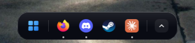
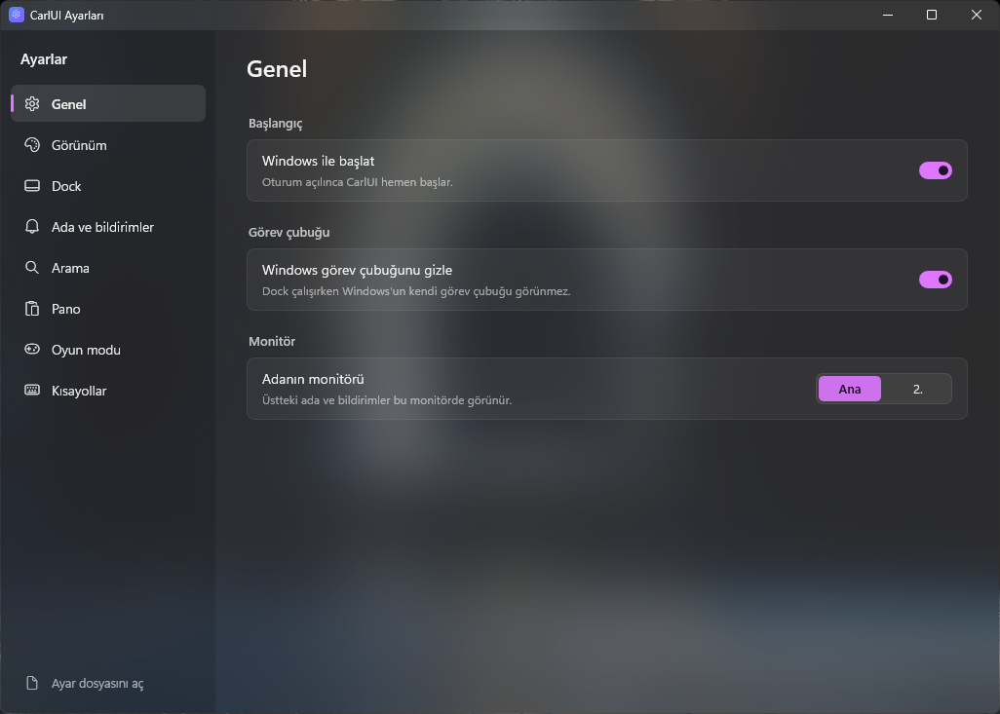
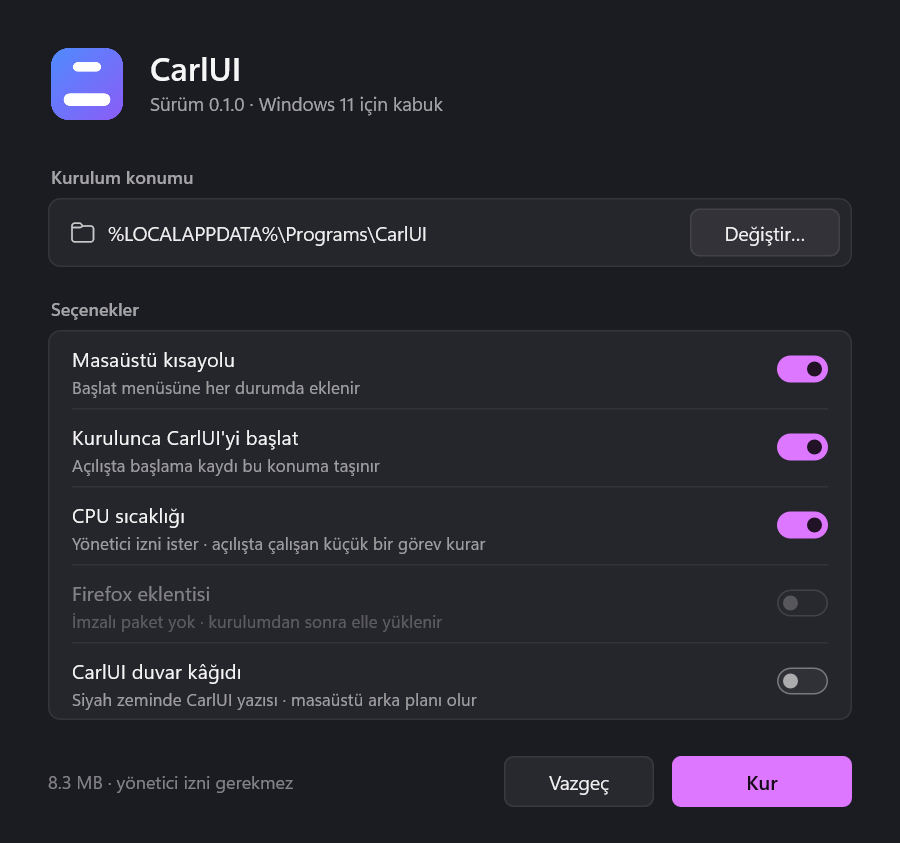

# CarlUI

Windows 11 için Rust ile yazılmış, hafif ve hızlı bir masaüstü kabuğu. Görev
çubuğunun yerine yüzen bir dock, ekranın üstünde saat/bildirim/medya adası,
Win menüsü, arama, pano geçmişi ve kontrol merkezi getirir.

Ücretsiz ve açık kaynaktır (MIT lisansı).

> **English:** CarlUI is a lightweight desktop shell for Windows 11, written in
> Rust. It replaces the taskbar with a floating dock and adds a top "island"
> (clock, notifications, media, downloads), a launcher with search and a
> calculator, clipboard history (Win+V, also over fullscreen games), a control
> center and a game mode. The interface is in English and Turkish (it follows
> the Windows display language; change it in Settings → General). Download
> `CarlUI-Setup.exe` from [Releases](https://github.com/Carl00-mpeek/CarlUI/releases);
> no admin rights needed. Free and open source (MIT).



| Ayarlar | Kurucu |
|---|---|
|  |  |

## Neler var?

- **Dock:** Sabitlenmiş ve açık uygulamalar, canlı pencere önizlemeleri,
  sürükle-bırak, otomatik gizleme, Win+1…9, Geri Dönüşüm Kutusu.
- **Ada:** Üst ortada saat; bildirimler, çalan şarkı (kapak, ilerleme,
  uygulamaya özel ses), indirme ilerlemesi.
- **Arama:** Windows tuşu ya da Ctrl+Space. Uygulamalar, dosyalar, hesap
  makinesi, birim/döviz çevirisi, web ve yapay zekâ kısayolları.
- **Win menüsü:** Sabitlenmiş uygulamalar, klasörler, güç düğmeleri.
- **Pano geçmişi (Win+V):** Metin ve resimler, arama, sabitleme, yerinde
  düzenleme, şifreleri gizleme ve kendiliğinden silme. Tam ekran oyunda da
  oyunu küçültmeden açılır.
- **Kontrol merkezi:** Tepsi ikonları, ses (çıkış aygıtı ve uygulama başına
  ses), Wi-Fi, Bluetooth, parlaklık.
- **Oyun modu:** Tam ekranda arayüz çekilir, modüller uyku moduna geçer,
  bildirimler oyundan sonra gösterilir.
- **Görev yöneticisi, dosya dönüştürücü, ekran görüntüsü aracı** ve hepsini
  yöneten **Ayarlar** penceresi.
- **Türkçe ve İngilizce arayüz:** Windows'un görüntü diline uyar; **Ayarlar →
  Genel → Dil** bölümünden değiştirilebilir.

## Kurulum

1. [Releases](https://github.com/Carl00-mpeek/CarlUI/releases) sayfasından `CarlUI-Setup.exe` dosyasını indir.
2. Çalıştır, **Kur**'a bas. Yönetici izni gerekmez; CarlUI
   `%LOCALAPPDATA%\Programs\CarlUI` klasörüne kurulur, Başlat menüsüne eklenir
   ve oturum açılınca kendiliğinden başlar.

**"Windows bilgisayarınızı korudu" uyarısı:** Kurucu imzasız olduğu için
SmartScreen bu uyarıyı gösterir. **Ek bilgi → Yine de çalıştır** ile devam
edebilirsin. Bazı antivirüsler de yanlış alarm verebilir: CarlUI görev
çubuğunu gizler, klavye kısayollarını yakalamak için klavye kancası kullanır ve
isteğe bağlı sıcaklık okuyucu yönetici olarak çalışır. Bunların hepsi yalnızca
bu bilgisayarda olur. CarlUI veri toplamaz; yalnızca senin istediğin işlerde
(döviz kuru, çeviri, web araması, indirmeler) internete bağlanır. Kaynak kodun
tamamı bu depoda.

Kurucunun test sürümünün [VirusTotal taraması](https://www.virustotal.com/gui/file/2e72ef0b882a7e761bbcce33dc5afdc82c5c74d329a3ad7bb52aabe735b28d78)
sonucunda 71 antivirüsten 69'u temiz buldu, Microsoft Defender da temiz
buldu. Yalnızca ESET'in genel "Kryptik" tahmini ve Bkav işaretledi; ikisi de
imzasız kurucularda sık görülen yanlış alarm türleri. İndirdiğin dosyanın
SHA-256 değerini Releases sayfasındakiyle karşılaştırabilirsin.

### İsteğe bağlı parçalar

- **CPU sıcaklığı:** Intel işlemcilerde sıcaklık için
  [PawnIO](https://pawnio.eu) sürücüsü gerekir. Kuruluysa kurucu "CPU
  sıcaklığı" seçeneğini açar; bir kez yönetici izni ister.
- **Tarayıcı eklentisi:** Tarayıcıda başlayan indirmeleri adaya taşır. Kurulum
  klasöründeki `extension` klasöründe gelir; nasıl yükleneceği **Ayarlar →
  Arama → Tarayıcı eklentisi** bölümünde anlatılır.

### Kaldırma

**Windows Ayarları → Uygulamalar → Yüklü uygulamalar** listesinden ya da Başlat menüsündeki **CarlUI'yi
kaldır** kısayolundan. Görev çubuğu geri gelir, kurulan dosyalar Geri Dönüşüm
Kutusu'na taşınır. Ayarların kalmasını ya da silinmesini sen seçersin.

**Acil durum:** Görev çubuğu bir şekilde geri gelmezse:

```powershell
& "$env:LOCALAPPDATA\Programs\CarlUI\carlui.exe" --restore-taskbar
```

### Duvar kâğıdı

CarlUI'nin kendi duvar kâğıdı [assets/wallpaper](assets/wallpaper) klasöründe
(1920×1080, 2560×1440, 3840×2160). `tools\make-wallpaper.ps1` ile yeniden
üretilebilir.

## Ayarlar ve veriler

| Ne | Nerede |
|---|---|
| Ayarlar | `%APPDATA%\CarlUI\config.toml` (Ayarlar penceresinden değiştirilir, anında uygulanır) |
| Pano geçmişi, önbellek | `%LOCALAPPDATA%\CarlUI\` |
| Loglar | `%LOCALAPPDATA%\CarlUI\logs\` (7 gün saklanır) |

## Kaynaktan derleme

Gerekenler: [Rust](https://rustup.rs) ve Visual Studio Build Tools (C++).

```powershell
cargo build --release
.\target\release\carlui.exe          # çalıştır
.\target\release\carlui.exe --quit   # kapat
```

Tek dosyalık kurucuyu üretmek için:

```powershell
powershell -ExecutionPolicy Bypass -File tools\build-setup.ps1   # → dist\CarlUI-Setup.exe
```

Mimari: her modül (dock, tepsi, ada, Win menüsü…) ayrı bir süreçtir; biri
çökerse ana süreç onu yeniden başlatır. Modüller adlandırılmış kanal üzerinden
konuşur. Ayrıntılı geliştirme notları ve test adımları:
[docs/GELISTIRME-NOTLARI.md](docs/GELISTIRME-NOTLARI.md).

## Lisans

MIT © 2026 Demhat Dayan. Ayrıntı: [LICENSE](LICENSE). Üçüncü taraf parçalar
(PawnIO IntelMSR modülü — LGPL-2.1, Rust kütüphaneleri) için:
[THIRD-PARTY-NOTICES.md](THIRD-PARTY-NOTICES.md).

Hata ve öneriler için [Issues](https://github.com/Carl00-mpeek/CarlUI/issues)
sayfasını kullanabilirsin. İletişim: maildemhat@gmail.com
