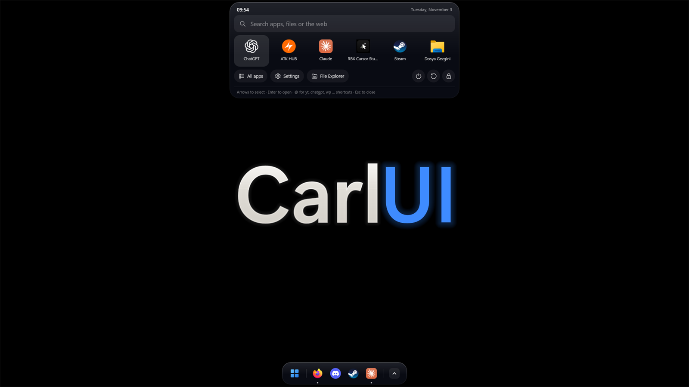
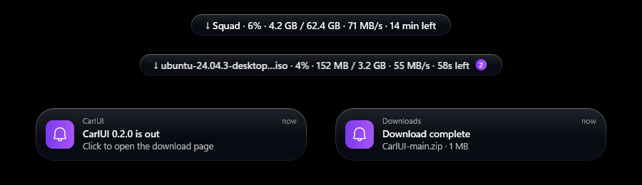
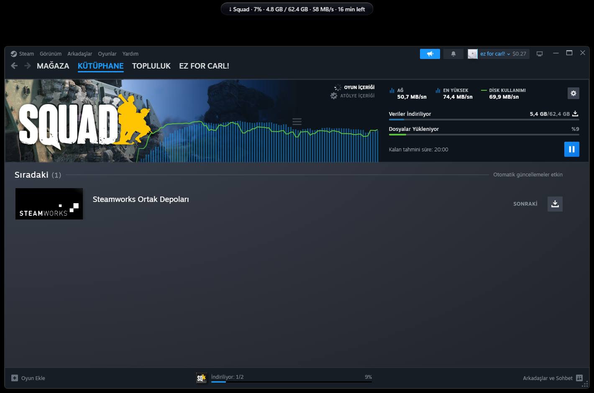
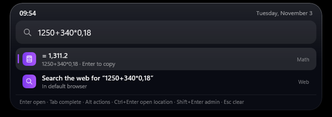
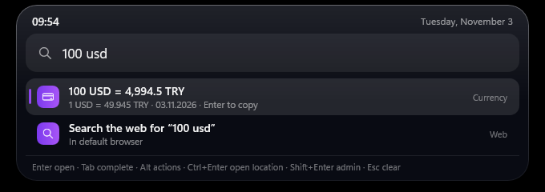
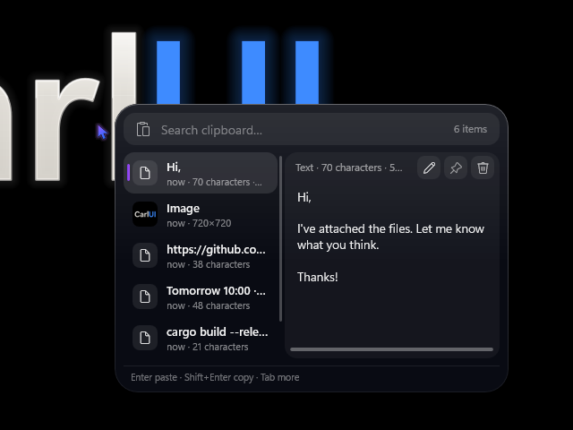
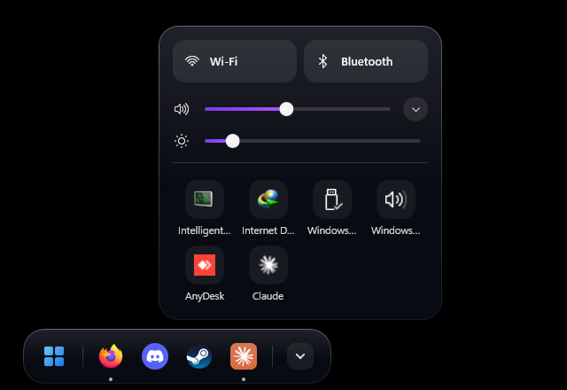
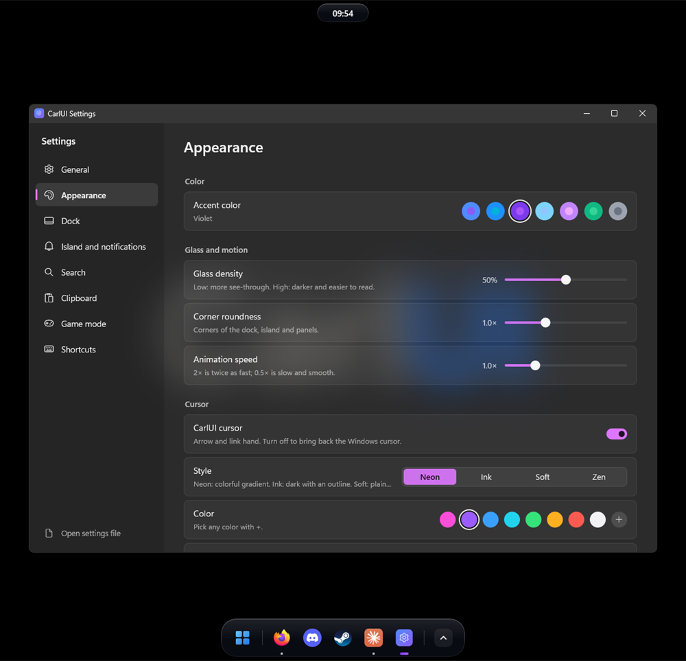
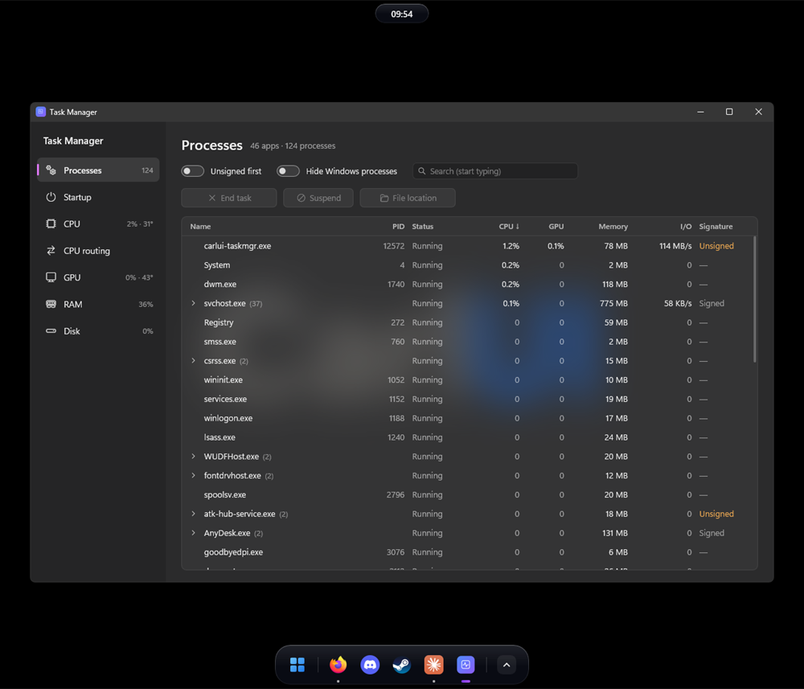
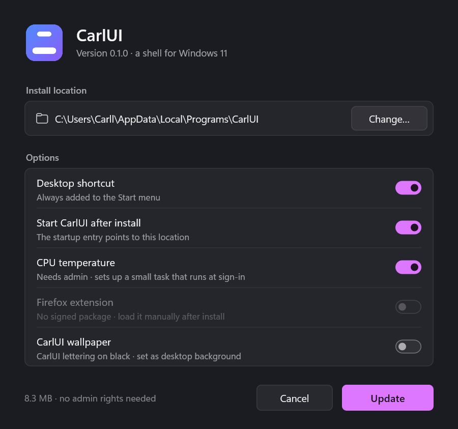

<p align="center">
  <a href="README.md"></a>
  <a href="README.tr.md"></a>
</p>

<h1 align="center">CarlUI</h1>

<p align="center">
  A lightweight, fast desktop shell for Windows 11, written in Rust.<br>
  Floating dock, a top island for the clock, notifications and media, search, clipboard history, a control center,<br>
  the Carl Vault password manager, instant replay and on-device AI.
</p>

<p align="center">
  <a href="https://github.com/Carl00-mpeek/CarlUI/releases/latest"></a>
  
  
  <a href="LICENSE"></a>
</p>

<p align="center">
  <a href="https://github.com/Carl00-mpeek/CarlUI/releases/latest"><b>⬇ Download CarlUI-Setup.exe</b></a>
  &nbsp;·&nbsp; no admin rights needed &nbsp;·&nbsp; free and open source
</p>



<p align="center">
  <br>
  <sub><b>Island</b> · live download progress (name, size, speed, time left), Steam games included, and notifications</sub>
</p>

<p align="center">
  <br>
  <sub><b>Steam download</b> · the game's name and total size come straight from Steam; downloaded amount, speed and time left are estimated from network and disk use</sub>
</p>

<table>
  <tr>
    <td width="50%"><br><sub><b>Search</b> · calculates as you type</sub></td>
    <td width="50%"><br><sub><b>Currency and unit conversion</b> · daily rates</sub></td>
  </tr>
  <tr>
    <td><br><sub><b>Clipboard history (Win+V)</b> · text and images, search, editing</sub></td>
    <td><br><sub><b>Control center</b> · volume, brightness, Wi-Fi, tray icons</sub></td>
  </tr>
  <tr>
    <td><br><sub><b>Settings</b> · everything in one window, applied instantly</sub></td>
    <td><br><sub><b>Task Manager</b> · unsigned programs first</sub></td>
  </tr>
  <tr>
    <td><br><sub><b>Installer</b> · one file, two languages, no admin rights</sub></td>
    <td></td>
  </tr>
</table>

## Features

- **Dock:** Pinned and running apps, live window previews, drag and drop,
  auto-hide, Win+1…9, Recycle Bin.
- **Island:** Clock at the top center; notifications, now playing (cover,
  progress, per-app volume), download progress with file name, size, speed
  and time left (each can be turned off in Settings). Downloads from other
  apps (Steam, Epic, torrent clients…) show up too: estimated from network and
  disk use, with the game's name and progress for Steam.
- **Search:** Windows key or Ctrl+Space. Apps, files, calculator,
  unit/currency conversion, web and AI shortcuts.
- **Win menu:** Pinned apps, folders, power buttons.
- **Clipboard history (Win+V):** Text and images, search, pinning, in-place
  editing, hidden passwords that delete themselves. Opens over fullscreen
  games without minimizing them.
- **Control center:** Tray icons, volume (output device and per-app volume),
  Wi-Fi, Bluetooth, brightness.
- **Alerts:** A notification when the CPU, GPU or an SSD passes the
  temperature you set, or when a drive is almost full. Limits are in
  **Settings → Island and notifications → Alerts**.
- **Game mode:** In fullscreen the UI steps aside, modules go to sleep and
  notifications wait until you're done.
- **Carl Office (free):** Opens and edits Excel, Word, PowerPoint and PDF
  files; no separate office suite or subscription needed.
  - **Excel (xlsx, xls, csv):** Cell editing, formulas (SUM, IF, VLOOKUP…),
    number/date/currency formats, colors.
  - **Word (docx):** Typing in page view, bold/italic, color, alignment,
    heading styles.
  - **PowerPoint (pptx):** Add, duplicate, delete and reorder slides, text
    boxes, fullscreen slideshow (F5).
  - **PDF:** Rotate, delete and reorder pages, merge PDFs, save a page on its
    own, add text to a page.
  - Saving keeps everything you didn't touch (charts, macros, images…) as it
    was. Nothing runs in the background; it's optional in the installer.
- **Carl Vault (Ctrl+Alt+P):** An encrypted password and 2FA vault. It stays
  on this PC only, encrypted with your master password (Argon2id +
  XChaCha20-Poly1305); nothing goes to the cloud.
  - Passwords, emails, cards, notes and 2FA entries; 2FA codes are generated
    in the vault.
  - Strong password generator and strength meter.
  - With the browser extension it fills login pages (Ctrl+Shift+L), offers to
    save new logins and changed passwords, and suggests a strong password on
    sign-up forms. It stores passkeys too.
  - Import from Bitwarden, Chrome, Edge, Brave, Firefox, 1Password, LastPass,
    KeePass, Proton Pass, Dashlane, NordPass; for 2FA from Aegis, 2FAS,
    andOTP, otpauth lists and the Google Authenticator export QR.
  - Locks itself after a period of inactivity, on sleep and when Windows
    locks.
- **Instant replay (Alt+F10):** While on, the screen and sound are recorded in
  the background and only the last 1–30 minutes are kept. Press the shortcut
  and that stretch is saved as an MP4 in `Videos\CarlUI`. Encoded on the
  graphics card (H.264 / H.265), so games don't slow down; works in exclusive
  fullscreen too. Settings for microphone, noise suppression, quality,
  resolution, frame rate and deleting old clips. **Alt+F8** opens a small
  control panel that doesn't steal focus from the game.
- **Screenshot (Alt+X):** All monitors freeze; select an area, draw, type,
  erase, undo, copy or save. **Ctrl+T** reads the text in the selection and
  copies it (OCR); QR codes in the selection are read, and a 2FA QR goes to
  Carl Vault with one button. Doesn't minimize fullscreen games. When done, a
  notification with **Open / Edit / Delete** appears on the island.
- **File converter (Win+Alt):** Converts the selected images, videos and audio
  files to other formats; turns video into GIF or extracts its audio.
- **Task manager:** Processes (unsigned programs first), every startup item,
  CPU (per core and temperature), GPU, RAM and disk graphs. A **Run as
  administrator** button for processes that need it.
- **Small tools:**
  - **Text expander:** Type an abbreviation like `;addr` and it's replaced
    with longer text; it stays off in apps you choose (games, terminals).
  - **Color picker**, **batch rename (Ctrl+Shift+R)** and **disk analyzer**
    (which folders take up space).
- **Download manager:** Paste a link into search and pick "Download" (or type
  `download <url>`); the file goes to Downloads with percent and speed on the
  island. Pause / resume / cancel.
- **Look:** Light / dark / system theme, accent color, glass density, corner
  radius, animation speed and an optional **CarlUI cursor** (turn it off to
  get the Windows cursor back).
- **Settings:** Everything in one window, applied instantly; export / import
  all settings as a single file. Text doesn't get cut off on small screens
  (1366×768) either.
- **Shortcuts:** All of them can be changed in **Settings → Shortcuts** (see
  the table below).
- **English and Turkish:** Follows the Windows display language; change it in
  **Settings → General → Language**.

### Shortcuts

| Shortcut | What it does |
|---|---|
| Windows key / Ctrl+Space | Win menu / search |
| Win+1…9 | Opens the 1st–9th app on the dock |
| Win+V | Clipboard history |
| Alt+X | Screenshot (in a selection, Ctrl+T: copy text, Ctrl+Shift+T: translate) |
| Win+Alt | File converter |
| Ctrl+Alt+P | Carl Vault |
| Ctrl+Shift+R | Batch rename |
| Alt+F10 / Alt+F8 | Instant replay: save the last minutes / open the panel |
| Ctrl+Alt+S | Read selected text aloud |
| Ctrl+Alt+D | Dictation |
| Ctrl+Alt+A (hold) | Voice assistant |

The color picker and disk analyzer have no shortcut by default; you can set one
in Settings.

### Search commands

- Type `yt`, `chatgpt`, `claude`, `grok`, `gemini` or `wp` to open that site or
  app; keep typing to search / ask there. `@` lists them all. `wp name message`
  opens that contact's WhatsApp chat with the message ready.
- `/lock`, `/restart`, `/shutdown`: lock, restart, shut down.
- `:fire`, `:heart`… copy an emoji. `>` lists open windows, `recent` lists
  recently opened files.
- `wifi off`, `bluetooth on`, `volume 30`, `mute`, `brightness 70`,
  `dark mode`: quick settings.

### AI

Everything runs on your PC; nothing goes to the cloud. Options are in
**Settings → AI**.

- **Voice studio:** Turn text into speech (save as WAV/MP3), or transcribe your
  voice or an audio/video file (TXT or SRT subtitles).
- **Read aloud (Ctrl+Alt+S):** Reads the selected text, or the clipboard;
  press again to stop. Turkish text gets a Turkish voice, English text an
  English voice.
- **Dictation (Ctrl+Alt+D):** Speak and your words are typed where the cursor
  is.
- **Voice assistant (Ctrl+Alt+A):** Hold the shortcut, say a command, let go:
  "open YouTube", "set volume to 30", "search lofi on YouTube". It does by
  voice anything search can do. It never listens all the time; optional in the
  installer and in Settings.
- **Screen translation:** Select an area in the screenshot tool and press
  **Ctrl+Shift+T**; English text on screen is translated to Turkish (or the
  other way round) and copied to the clipboard.
- **Voice-triggered clips:** With instant replay on, say "save the last two
  minutes" to save a clip.
- **Remove background** and **image quality enhancement:** Sharpens blurry or
  small photos 2-4×. Both are in the file converter's "AI" section.

**Models:** None ship with the installer. In the Voice studio you pick the one
you want from a **Small / Medium / Large** list; each shows its size, license
and recommended system, and an orange warning appears if your PC is below the
recommendation. Models are downloaded only from their official source and
verified with SHA-256. With a graphics card (DirectML) they run much faster;
otherwise the CPU is used. The Turkish voice (Piper dfki) has a non-commercial
license: personal use is fine, but it can't be used for paid work (ads, paid
voice-over). You're asked about this before it downloads.

## Install

1. Download `CarlUI-Setup.exe` from [Releases](https://github.com/Carl00-mpeek/CarlUI/releases/latest).
2. Run it and click **Install**. No admin rights needed: CarlUI installs to
   `%LOCALAPPDATA%\Programs\CarlUI`, adds itself to the Start menu and starts
   when you sign in.

**"Windows protected your PC":** The installer isn't code-signed, so
SmartScreen shows this warning. Click **More info → Run anyway**. Some
antivirus tools may raise a false alarm too: CarlUI hides the taskbar, uses a
keyboard hook for its shortcuts, and the optional temperature reader runs as
admin. All of this stays on your PC. CarlUI collects no data; it only goes
online for things you ask for (currency rates, translation, web search,
downloads, the daily update check). All of the source code is in this repo.

A [VirusTotal scan](https://www.virustotal.com/gui/file/3563d3310a40bc053c981eb4d83b9694dc96d62a26b3439e282ff4ace31e3597)
of the current installer: 68 of 71 engines, including Microsoft Defender,
found it clean. Only ESET's generic "Kryptik" heuristic, Bkav and SecureAge
flagged it, all common false positives for unsigned installers. You can
compare the SHA-256 of your download with the one on the Releases page.

### Optional parts

- **CPU temperature:** Intel CPUs need the [PawnIO](https://pawnio.eu) driver.
  If it's installed, the installer turns on "CPU temperature"; it asks for
  admin rights once.
- **Browser extension:** Moves downloads started in the browser to the island
  and fills login pages from Carl Vault.
  It ships in `%LOCALAPPDATA%\Programs\CarlUI\extension\carlui-downloads`; turn
  on developer mode on your browser's extensions page and use **Load unpacked**
  on that folder. See **Settings → Search → Browser extension**.
- **Wallpaper:** The installer's "CarlUI wallpaper" option. Files are in
  [assets/wallpaper](assets/wallpaper) (1920×1080, 2560×1440, 3840×2160) and
  can be regenerated with `tools\make-wallpaper.ps1`.

### Updates

Once a day CarlUI checks GitHub for a new version and, if there is one, shows
a notification on the island. Nothing happens until you click it: then CarlUI
downloads the new installer, checks its SHA-256 against the release, installs
it silently and restarts. Your settings are kept. If something goes wrong, the
notification links to the release page so you can update by hand. Turn the
check off in **Settings → General → System**.

### Uninstall

From **Windows Settings → Apps → Installed apps**, or the **Uninstall CarlUI**
shortcut in the Start menu. The taskbar comes back and installed files go to
the Recycle Bin. You choose whether to keep your settings.

**Emergency:** If the taskbar somehow doesn't come back:

```powershell
& "$env:LOCALAPPDATA\Programs\CarlUI\carlui.exe" --restore-taskbar
```

## Settings and data

| What | Where |
|---|---|
| Program | `%LOCALAPPDATA%\Programs\CarlUI\` |
| Settings | `%APPDATA%\CarlUI\config.toml` (edited from the Settings window, applied instantly) |
| Clipboard history, cache | `%LOCALAPPDATA%\CarlUI\` |
| Carl Vault | `%APPDATA%\CarlUI\vault\vault.json` (encrypted with your master password) |
| Instant replay clips | `Videos\CarlUI\` (folder can be changed in Settings) |
| AI models | `%LOCALAPPDATA%\CarlUI\models\` (remove them from the Voice studio) |
| Logs | `%LOCALAPPDATA%\CarlUI\logs\` (kept for 7 days) |

## Building from source

You need [Rust](https://rustup.rs) and Visual Studio Build Tools (C++).

```powershell
cargo build --release
.\target\release\carlui.exe          # run
.\target\release\carlui.exe --quit   # quit
```

To build the single-file installer:

```powershell
powershell -ExecutionPolicy Bypass -File tools\build-setup.ps1   # → dist\CarlUI-Setup.exe
```

Architecture: every module (dock, tray, island, Win menu…) is its own
process; if one crashes, the main process restarts it. Modules talk over a
named pipe. UI strings live side by side in both languages:
`t!("Kapat", "Close")`. Development notes (in Turkish):
[docs/GELISTIRME-NOTLARI.md](docs/GELISTIRME-NOTLARI.md).

## Code signing policy

Windows installers are to be signed for free through
[SignPath.io](https://about.signpath.io), with a certificate from
[SignPath Foundation](https://signpath.org) (application in progress).

- Only `CarlUI-Setup.exe` built by the [Release workflow](.github/workflows/release.yml)
  from this repository's source gets signed; nothing built on a personal
  machine.
- Committers, reviewers and approvers: [Carl00-mpeek](https://github.com/Carl00-mpeek)
  (the only maintainer). Every release is approved by hand.

### Privacy

CarlUI collects no data and has no telemetry. It only connects to other
systems when you ask it to (currency rates, translation, web search,
downloads, model downloads) and for the daily update check against the GitHub
API, which can be turned off in **Settings → General → System**. AI features
run entirely on your PC; your voice, text and images are never sent anywhere.

## License

MIT © 2026 Demhat Dayan. See [LICENSE](LICENSE). Third-party parts (PawnIO
IntelMSR module, LGPL-2.1, Rust crates, and the optional AI models and their
licenses):
[THIRD-PARTY-NOTICES.md](THIRD-PARTY-NOTICES.md).

Bugs and ideas: [Issues](https://github.com/Carl00-mpeek/CarlUI/issues).
Contact: maildemhat@gmail.com
