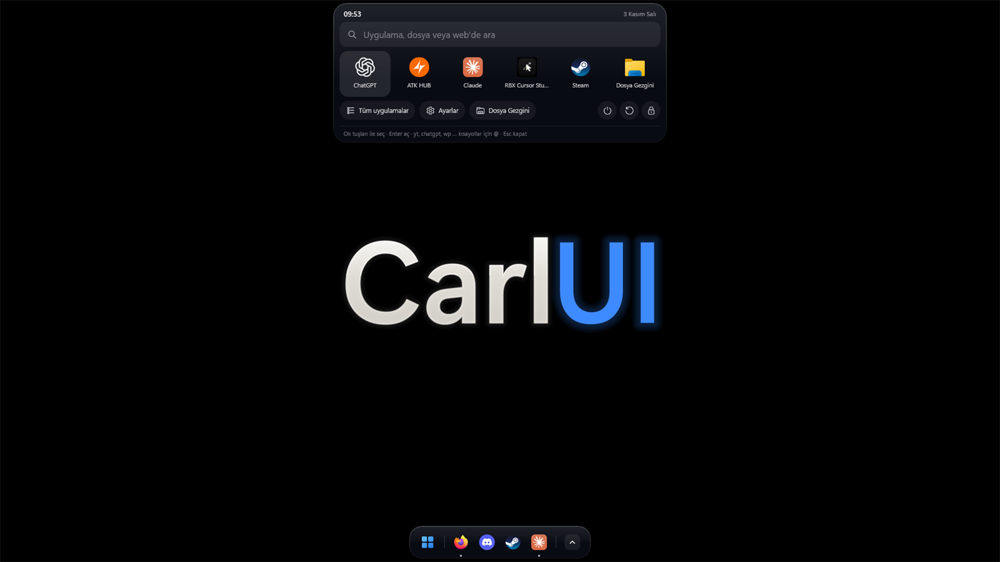
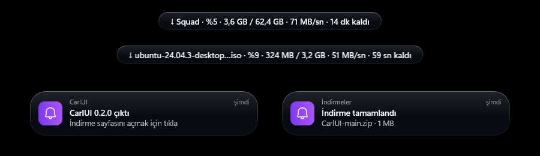
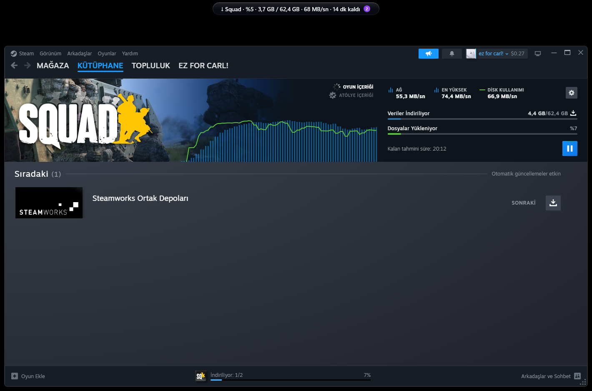
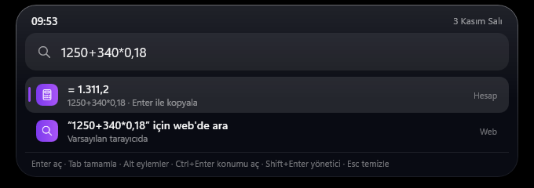
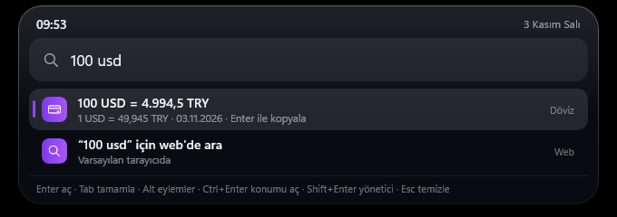
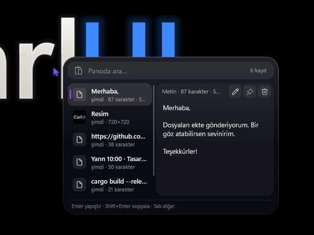
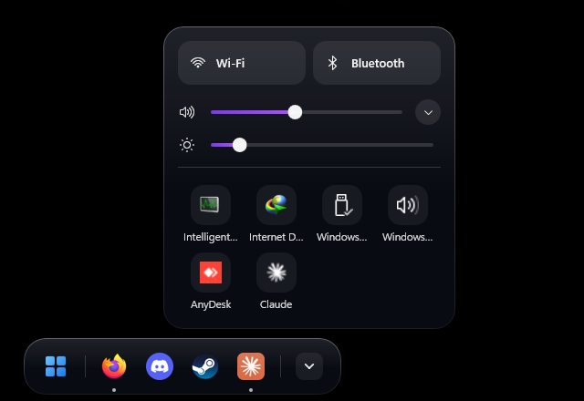
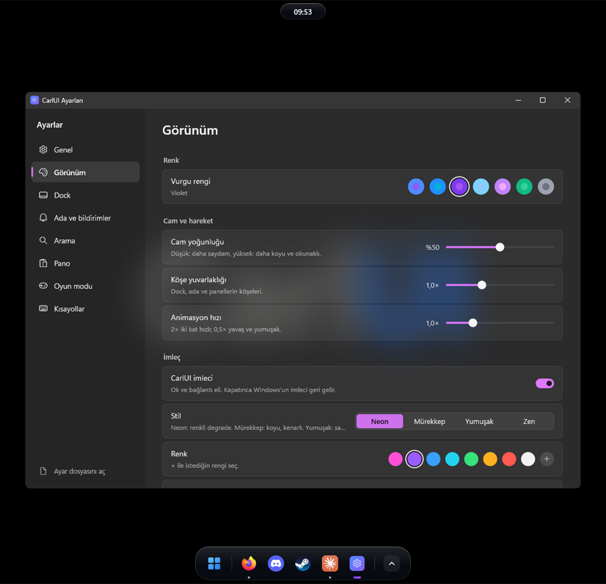
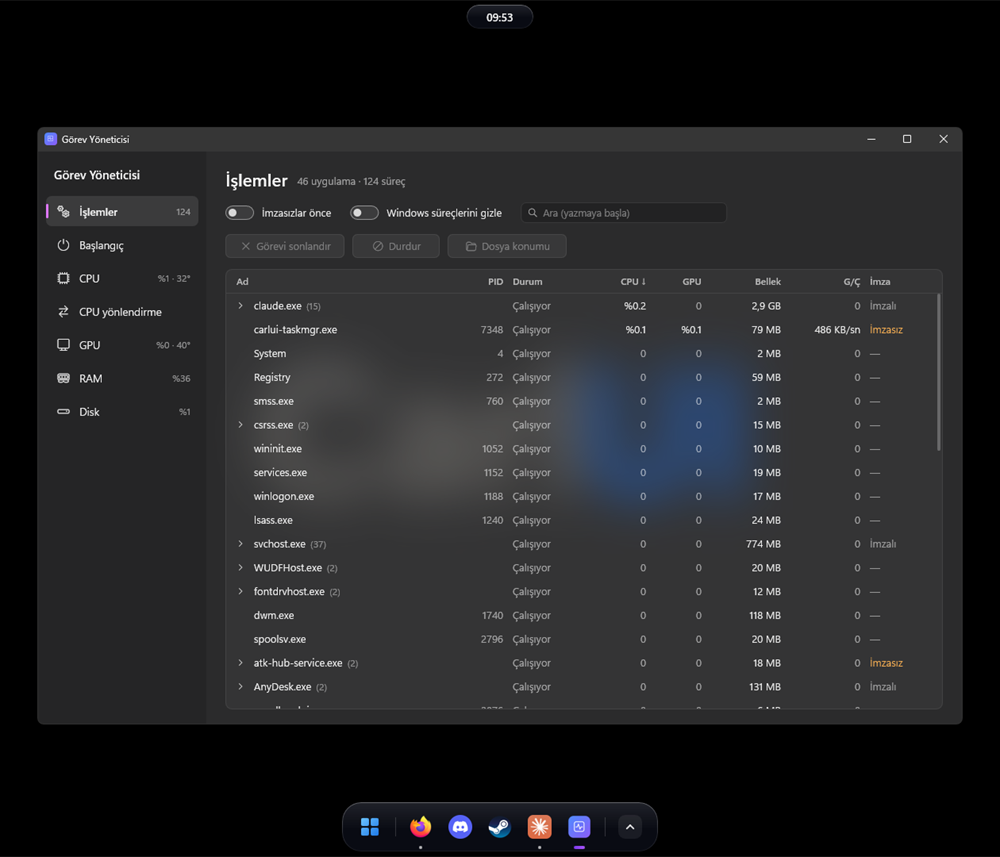
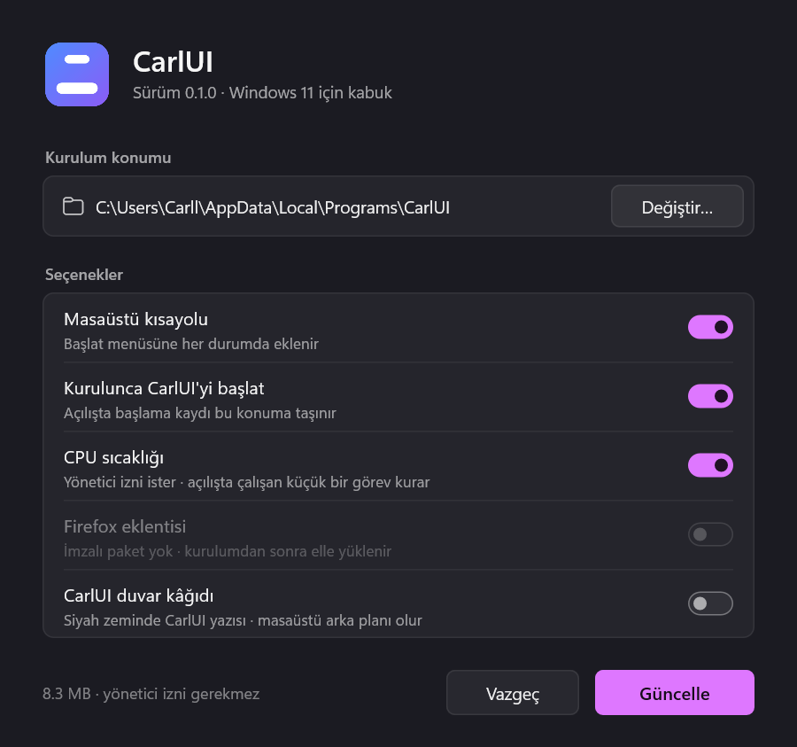

<p align="center">
  <a href="README.md"></a>
  <a href="README.tr.md"></a>
</p>

<h1 align="center">CarlUI</h1>

<p align="center">
  Windows 11 için Rust ile yazılmış, hafif ve hızlı bir masaüstü kabuğu.<br>
  Yüzen dock, üstte saat/bildirim/medya adası, arama, pano geçmişi, kontrol merkezi,<br>
  Carl Vault parola kasası, anlık tekrar ve yerel yapay zekâ.
</p>

<p align="center">
  <a href="https://github.com/Carl00-mpeek/CarlUI/releases/latest"></a>
  
  
  <a href="LICENSE"></a>
</p>

<p align="center">
  <a href="https://github.com/Carl00-mpeek/CarlUI/releases/latest"><b>⬇ CarlUI-Setup.exe indir</b></a>
  &nbsp;·&nbsp; yönetici izni gerekmez &nbsp;·&nbsp; ücretsiz ve açık kaynak
</p>



<p align="center">
  <br>
  <sub><b>Ada</b> · canlı indirme ilerlemesi (ad, boyut, hız, kalan süre), Steam oyunları dahil, ve bildirimler</sub>
</p>

<p align="center">
  <br>
  <sub><b>Steam indirmesi</b> · oyunun adı ve toplam boyutu Steam'den birebir gelir; inen miktar, hız ve kalan süre ağ ve disk kullanımından tahmin edilir</sub>
</p>

<table>
  <tr>
    <td width="50%"><br><sub><b>Arama</b> · yazdıkça hesaplar</sub></td>
    <td width="50%"><br><sub><b>Döviz ve birim çevirisi</b> · günlük kur</sub></td>
  </tr>
  <tr>
    <td><br><sub><b>Pano geçmişi (Win+V)</b> · metin ve resim, arama, düzenleme</sub></td>
    <td><br><sub><b>Kontrol merkezi</b> · ses, parlaklık, Wi-Fi, tepsi ikonları</sub></td>
  </tr>
  <tr>
    <td><br><sub><b>Ayarlar</b> · her şey tek pencerede, anında uygulanır</sub></td>
    <td><br><sub><b>Görev yöneticisi</b> · imzasız programlar öne</sub></td>
  </tr>
  <tr>
    <td><br><sub><b>Kurucu</b> · tek dosya, iki dil, yönetici izni gerekmez</sub></td>
    <td></td>
  </tr>
</table>

## Neler var?

- **Dock:** Sabitlenmiş ve açık uygulamalar, canlı pencere önizlemeleri,
  sürükle-bırak, otomatik gizleme, Win+1…9, Geri Dönüşüm Kutusu.
- **Ada:** Üst ortada saat; bildirimler, çalan şarkı (kapak, ilerleme,
  uygulamaya özel ses), indirme ilerlemesi: dosya adı, boyut, hız ve kalan
  süre (her biri Ayarlar'dan kapatılabilir). Başka programların (Steam, Epic,
  torrent…) indirmeleri de görünür: internet ve disk kullanımından tahmin
  edilir, Steam'de oyunun adı ve ilerlemesi de gelir.
- **Arama:** Windows tuşu ya da Ctrl+Space. Uygulamalar, dosyalar, hesap
  makinesi, birim/döviz çevirisi, web ve yapay zekâ kısayolları.
- **Win menüsü:** Sabitlenmiş uygulamalar, klasörler, güç düğmeleri.
- **Pano geçmişi (Win+V):** Metin ve resimler, arama, sabitleme, yerinde
  düzenleme, şifreleri gizleme ve kendiliğinden silme. Tam ekran oyunda da
  oyunu küçültmeden açılır.
- **Kontrol merkezi:** Tepsi ikonları, ses (çıkış aygıtı ve uygulama başına
  ses), Wi-Fi, Bluetooth, parlaklık.
- **Uyarılar:** CPU, GPU ya da SSD belirlediğin sıcaklığı geçince veya bir
  sürücü dolmak üzereyken bildirim gelir. Sınırlar **Ayarlar → Ada ve
  bildirimler → Uyarılar** bölümünde.
- **Oyun modu:** Tam ekranda arayüz çekilir, modüller uyku moduna geçer,
  bildirimler oyundan sonra gösterilir.
- **Carl Office (ücretsiz):** Excel, Word, PowerPoint ve PDF dosyalarını
  açar ve düzenler; ayrı bir ofis programı ya da abonelik gerekmez.
  - **Excel (xlsx, xls, csv):** Hücre düzenleme, Türkçe formüller (TOPLA,
    EĞER, DÜŞEYARA…), sayı/tarih/para biçimleri, renkler.
  - **Word (docx):** Sayfa görünümünde yazma, kalın/italik, renk, hizalama,
    başlık biçemleri.
  - **PowerPoint (pptx):** Slayt ekleme, çoğaltma, silme ve taşıma, metin
    kutuları, tam ekran sunum (F5).
  - **PDF:** Sayfa döndürme, silme, taşıma, PDF birleştirme, sayfayı ayrı
    kaydetme, sayfaya metin yazma.
  - Kaydederken dokunmadığın her şey (grafik, makro, resim…) olduğu gibi
    kalır. Arka planda çalışmaz; kurucuda isteğe bağlıdır.
- **Carl Vault (Ctrl+Alt+P):** Şifreli parola ve 2FA kasası. Kasa yalnızca
  bu bilgisayarda durur, ana parolayla (Argon2id + XChaCha20-Poly1305)
  şifrelenir; hiçbir şey buluta gitmez.
  - Parola, e-posta, kart, not ve 2FA kayıtları; 2FA kodları kasada üretilir.
  - Güçlü parola üretici ve güç göstergesi.
  - Tarayıcı eklentisiyle giriş sayfalarını doldurur (Ctrl+Shift+L), yeni
    girişte ya da parola değişince kaydetmeyi sorar, kayıt formunda güçlü
    parola önerir. Passkey de saklar.
  - İçe aktarma: Bitwarden, Chrome, Edge, Brave, Firefox, 1Password, LastPass,
    KeePass, Proton Pass, Dashlane, NordPass; 2FA için Aegis, 2FAS, andOTP,
    otpauth listeleri ve Google Authenticator aktarım QR'ı.
  - Bir süre kullanılmayınca, uykuda ve Windows kilitlenince kendiliğinden
    kilitlenir.
- **Anlık tekrar (Alt+F10):** Açıkken ekran ve ses arka planda kaydedilir,
  yalnızca son 1–30 dakika tutulur. Kısayola basınca o süre MP4 olarak
  `Videolar\CarlUI` klasörüne kaydedilir. Ekran kartında kodlanır (H.264 /
  H.265), oyunu yavaşlatmaz, özel tam ekranda da çalışır. Mikrofon, gürültü
  engelleme, kalite, çözünürlük, kare hızı ve eski klipleri silme ayarları var.
  **Alt+F8** oyunun odağını almayan küçük denetim panelini açar.
- **Ekran görüntüsü (Alt+X):** Tüm monitörler donar; alan seç, çiz, yaz, sil,
  geri al, kopyala ya da kaydet. **Ctrl+T** seçimdeki yazıyı okuyup panoya
  koyar (OCR); seçimdeki QR kodu okunur, 2FA QR'ı tek düğmeyle Carl Vault'a
  gider. Tam ekran oyunda oyunu küçültmez. Bitince adada **Aç / Düzenle / Sil**
  düğmeli bildirim çıkar.
- **Dosya dönüştürücü (Win+Alt):** Seçili resim, video ve ses dosyalarını
  başka biçime çevirir; videodan GIF ya da ses çıkarır.
- **Görev yöneticisi:** İşlemler (imzasız programlar öne), tüm başlangıç
  öğeleri, CPU (çekirdek başına ve sıcaklık), GPU, RAM ve disk grafikleri.
  Yetki isteyen süreçler için **Yönetici olarak çalıştır** düğmesi var.
- **Küçük araçlar:**
  - **Metin genişletici:** `;adres` gibi bir kısaltma yazınca yerine uzun
    metin gelir; seçtiğin uygulamalarda (oyun, terminal) çalışmaz.
  - **Renk seçici**, **toplu yeniden adlandırma (Ctrl+Shift+R)** ve
    **disk analizörü** (hangi klasör ne kadar yer kaplıyor).
- **İndirme yöneticisi:** Aramaya bağlantı yapıştırıp "İndir" de (ya da
  `indir <adres>` yaz); dosya İndirilenler'e iner, adada yüzde ve hız görünür.
  Duraklat / sürdür / iptal.
- **Görünüm:** Açık / koyu / sistem teması, vurgu rengi, cam yoğunluğu, köşe
  yuvarlaklığı, animasyon hızı ve isteğe bağlı **CarlUI imleci** (kapatınca
  Windows'un imleci geri gelir).
- **Ayarlar:** Hepsi tek pencerede, anında uygulanır; ayarları tek bir dosyaya
  dışa / içe aktarabilirsin. Küçük ekranlarda (1366×768) da yazılar kesilmez.
- **Kısayollar:** Hepsi **Ayarlar → Kısayollar** sayfasından değiştirilebilir
  (aşağıdaki tabloya bak).
- **Türkçe ve İngilizce arayüz:** Windows'un görüntü diline uyar; **Ayarlar →
  Genel → Dil** bölümünden değiştirilebilir.

### Kısayollar

| Kısayol | Ne yapar |
|---|---|
| Windows tuşu / Ctrl+Space | Win menüsü / arama |
| Win+1…9 | Dock'taki 1.–9. uygulamayı açar |
| Win+V | Pano geçmişi |
| Alt+X | Ekran görüntüsü (seçimde Ctrl+T: yazıyı kopyala, Ctrl+Shift+T: çevir) |
| Win+Alt | Dosya dönüştürücü |
| Ctrl+Alt+P | Carl Vault |
| Ctrl+Shift+R | Toplu yeniden adlandırma |
| Alt+F10 / Alt+F8 | Anlık tekrar: son dakikaları kaydet / paneli aç |
| Ctrl+Alt+S | Seçili metni sesli oku |
| Ctrl+Alt+D | Dikte |
| Ctrl+Alt+A (basılı tut) | Sesli asistan |

Renk seçici ve disk analizörü için kısayol yok; istersen Ayarlar'dan atarsın.

### Arama komutları

- `yt`, `chatgpt`, `claude`, `grok`, `gemini`, `wp` yazınca ilgili site ya da
  uygulama açılır; ardından metin yazarsan orada arar / sorar. `@` hepsini
  listeler. `wp ad mesaj` kişinin WhatsApp sohbetini mesaj hazır açar.
- `/lock`, `/restart`, `/shutdown`: kilitle, yeniden başlat, kapat.
- `:gül`, `:kalp`… emoji kopyalar. `>` açık pencereleri, `son` son açılan
  dosyaları listeler.
- `wifi kapat`, `bluetooth aç`, `ses 30`, `sessiz`, `parlaklık 70`,
  `karanlık mod`: hızlı ayarlar.

### Yapay zekâ

Hepsi bilgisayarında çalışır, hiçbir şey buluta gitmez. Ayarlar **Ayarlar →
Yapay zekâ** sayfasında.

- **Ses stüdyosu:** Metni sese çevir (WAV/MP3 kaydet) ya da konuşmanı veya bir
  ses/video dosyasını yazıya dök (TXT ya da SRT altyazı).
- **Sesli okuma (Ctrl+Alt+S):** Seçili metni, yoksa panodakini okur; yeniden
  basınca susar. Türkçe metin Türkçe sesle, İngilizce metin İngilizce sesle
  okunur.
- **Dikte (Ctrl+Alt+D):** Konuş, söylediklerin imlecin olduğu yere yazılsın.
- **Sesli asistan (Ctrl+Alt+A):** Kısayolu basılı tut, komutu söyle, bırak:
  "YouTube'u aç", "sesi 30 yap", "YouTube'da lofi ara". Aramanın yaptığı
  her şeyi sesle yapar. Sürekli dinlemez; kurucuda ve Ayarlar'da isteğe bağlı.
- **Ekran çevirisi:** Ekran görüntüsü aracında alan seçip **Ctrl+Shift+T**'ye
  bas; ekrandaki İngilizce yazı Türkçeye (ya da tersi) çevrilip panoya konur.
- **Sesli komutla klip:** Anlık tekrar açıkken "son iki dakikayı kaydet" de,
  klip kaydedilsin.
- **Arka planı sil** ve **resim kalitesi artırma:** Bulanık ya da küçük
  fotoğrafları 2-4 kat netleştirir. İkisi de dosya dönüştürücünün "Yapay zekâ"
  bölümünde.

**Modeller:** Kurucuda model yok. Ses stüdyosunda **Küçük / Orta / Büyük**
listesinden istediğini seçip indirirsin; her modelde boyut, lisans ve önerilen
sistem yazar, bilgisayarın önerilenin altındaysa turuncu uyarı çıkar. Modeller
yalnızca resmi kaynağından iner ve SHA-256 ile doğrulanır. Ekran kartı varsa
(DirectML) çok daha hızlı çalışır, yoksa işlemci kullanılır. Türkçe ses (Piper
dfki) ticari olmayan lisanslıdır: kişisel kullanım serbest, para kazanılan
işlerde (reklam, ücretli seslendirme) kullanılamaz; indirmeden önce bu açıkça
sorulur.

## Kurulum

1. [Releases](https://github.com/Carl00-mpeek/CarlUI/releases/latest) sayfasından `CarlUI-Setup.exe` dosyasını indir.
2. Çalıştır, **Kur**'a bas. Yönetici izni gerekmez; CarlUI
   `%LOCALAPPDATA%\Programs\CarlUI` klasörüne kurulur, Başlat menüsüne eklenir
   ve oturum açılınca kendiliğinden başlar.

**"Windows bilgisayarınızı korudu" uyarısı:** Kurucu imzasız olduğu için
SmartScreen bu uyarıyı gösterir. **Ek bilgi → Yine de çalıştır** ile devam
edebilirsin. Bazı antivirüsler de yanlış alarm verebilir: CarlUI görev
çubuğunu gizler, klavye kısayollarını yakalamak için klavye kancası kullanır ve
isteğe bağlı sıcaklık okuyucu yönetici olarak çalışır. Bunların hepsi yalnızca
bu bilgisayarda olur. CarlUI veri toplamaz; yalnızca senin istediğin işlerde
(döviz kuru, çeviri, web araması, indirmeler, günlük sürüm denetimi) internete
bağlanır. Kaynak kodun tamamı bu depoda.

Güncel kurucunun [VirusTotal taraması](https://www.virustotal.com/gui/file/3563d3310a40bc053c981eb4d83b9694dc96d62a26b3439e282ff4ace31e3597)
sonucunda 71 antivirüsten 68'i temiz buldu, Microsoft Defender da temiz
buldu. Yalnızca ESET'in genel "Kryptik" tahmini, Bkav ve SecureAge
işaretledi; üçü de imzasız kurucularda sık görülen yanlış alarm türleri. İndirdiğin dosyanın
SHA-256 değerini Releases sayfasındakiyle karşılaştırabilirsin.

### İsteğe bağlı parçalar

- **CPU sıcaklığı:** Intel işlemcilerde sıcaklık için
  [PawnIO](https://pawnio.eu) sürücüsü gerekir. Kuruluysa kurucu "CPU
  sıcaklığı" seçeneğini açar; bir kez yönetici izni ister.
- **Tarayıcı eklentisi:** Tarayıcıda başlayan indirmeleri adaya taşır
  ve giriş sayfalarını Carl Vault kasasından doldurur.
  `%LOCALAPPDATA%\Programs\CarlUI\extension\carlui-downloads` klasöründe gelir;
  tarayıcının eklentiler sayfasında geliştirici modunu açıp **Paketlenmemiş öğe
  yükle** ile bu klasörü seç. Ayrıntı: **Ayarlar → Arama → Tarayıcı eklentisi**.
- **Duvar kâğıdı:** Kurucuda "CarlUI duvar kâğıdı" seçeneği. Dosyalar
  [assets/wallpaper](assets/wallpaper) klasöründe (1920×1080, 2560×1440,
  3840×2160); `tools\make-wallpaper.ps1` ile yeniden üretilebilir.

### Güncelleme

CarlUI günde bir kez GitHub'da yeni sürüm olup olmadığına bakar; varsa adada
bildirim çıkar. Sen tıklamadıkça hiçbir şey olmaz. Tıklayınca CarlUI yeni
kurucuyu indirir, SHA-256 değerini sürümdekiyle karşılaştırır, sessizce kurar
ve yeniden başlar. Ayarların korunur. Bir sorun çıkarsa bildirim sürüm
sayfasına yönlendirir, oradan elle güncelleyebilirsin. Denetim **Ayarlar →
Genel → Sistem** bölümünden kapatılabilir.

### Kaldırma

**Windows Ayarları → Uygulamalar → Yüklü uygulamalar** listesinden ya da Başlat menüsündeki **CarlUI'yi
kaldır** kısayolundan. Görev çubuğu geri gelir, kurulan dosyalar Geri Dönüşüm
Kutusu'na taşınır. Ayarların kalmasını ya da silinmesini sen seçersin.

**Acil durum:** Görev çubuğu bir şekilde geri gelmezse:

```powershell
& "$env:LOCALAPPDATA\Programs\CarlUI\carlui.exe" --restore-taskbar
```

## Ayarlar ve veriler

| Ne | Nerede |
|---|---|
| Program | `%LOCALAPPDATA%\Programs\CarlUI\` |
| Ayarlar | `%APPDATA%\CarlUI\config.toml` (Ayarlar penceresinden değiştirilir, anında uygulanır) |
| Pano geçmişi, önbellek | `%LOCALAPPDATA%\CarlUI\` |
| Carl Vault kasası | `%APPDATA%\CarlUI\vault\vault.json` (ana parolayla şifreli) |
| Anlık tekrar klipleri | `Videolar\CarlUI\` (klasör Ayarlar'dan değiştirilebilir) |
| Yapay zekâ modelleri | `%LOCALAPPDATA%\CarlUI\models\` (Ses stüdyosundan silinebilir) |
| Loglar | `%LOCALAPPDATA%\CarlUI\logs\` (7 gün saklanır) |

## Kaynaktan derleme

Gerekenler: [Rust](https://rustup.rs) ve Visual Studio Build Tools (C++).

```powershell
cargo build --release
.\target\release\carlui.exe          # çalıştır
.\target\release\carlui.exe --quit   # kapat
```

Tek dosyalık kurucuyu üretmek için:

```powershell
powershell -ExecutionPolicy Bypass -File tools\build-setup.ps1   # → dist\CarlUI-Setup.exe
```

Mimari: her modül (dock, tepsi, ada, Win menüsü…) ayrı bir süreçtir; biri
çökerse ana süreç onu yeniden başlatır. Modüller adlandırılmış kanal üzerinden
konuşur. Arayüz metinleri kodda iki dilde yan yana durur:
`t!("Kapat", "Close")`. Ayrıntılı geliştirme notları ve test adımları:
[docs/GELISTIRME-NOTLARI.md](docs/GELISTIRME-NOTLARI.md).

## Kod imzalama

Windows kurucusunun [SignPath.io](https://about.signpath.io) üzerinden,
[SignPath Foundation](https://signpath.org) sertifikasıyla ücretsiz
imzalanması için başvuru yapıldı.

- Yalnızca bu depodaki koddan [Release iş akışıyla](.github/workflows/release.yml)
  derlenen `CarlUI-Setup.exe` imzalanır; kişisel bilgisayarda derlenen hiçbir
  şey imzalanmaz.
- Kodu yazan, inceleyen ve onaylayan: [Carl00-mpeek](https://github.com/Carl00-mpeek)
  (tek geliştirici). Her sürüm elle onaylanır.

### Gizlilik

CarlUI veri toplamaz, telemetri içermez. Yalnızca senin istediğin işlerde
(döviz kuru, çeviri, web araması, indirmeler, model indirme) ve günlük
güncelleme denetiminde (GitHub API) internete bağlanır; denetim **Ayarlar →
Genel → Sistem** bölümünden kapatılabilir. Yapay zekâ özellikleri
tamamen bilgisayarında çalışır; ses, metin ve görüntülerin hiçbir yere
gönderilmez.

## Lisans

MIT © 2026 Demhat Dayan. Ayrıntı: [LICENSE](LICENSE). Üçüncü taraf parçalar
(PawnIO IntelMSR modülü — LGPL-2.1, Rust kütüphaneleri, isteğe bağlı yapay
zekâ modelleri ve lisansları) için:
[THIRD-PARTY-NOTICES.md](THIRD-PARTY-NOTICES.md).

Hata ve öneriler için [Issues](https://github.com/Carl00-mpeek/CarlUI/issues)
sayfasını kullanabilirsin. İletişim: maildemhat@gmail.com
